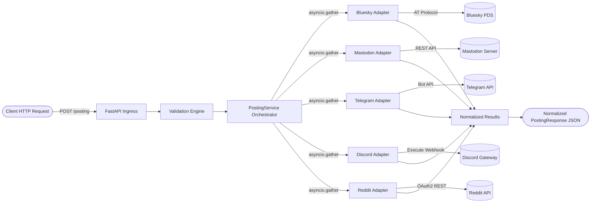

# NEXUS — Multi-Platform Publishing Engine

A modular, asynchronous Python publishing engine built with FastAPI, integrating multiple third-party social and messaging platforms through their official APIs with independent concurrent execution, strict input validation, and fault-tolerant publishing.

---

## Table of Contents

- [Overview](#overview)
- [Key Features](#key-features)
- [Technology Stack](#technology-stack)
- [Architecture & Design](#architecture--design)
- [Project Directory Structure](#project-directory-structure)
- [Supported Platforms](#supported-platforms)
- [Prerequisites & Installation](#prerequisites--installation)
- [Environment Configuration](#environment-configuration)
- [Running the Application](#running-the-application)
- [Interactive API Documentation](#interactive-api-documentation)
- [API Usage & Examples](#api-usage--examples)
- [Testing & Quality Assurance](#testing--quality-assurance)
- [Security Considerations](#security-considerations)
- [Known Limitations](#known-limitations)
- [Future Improvements](#future-improvements)

---

## Overview

Modern software products often need to broadcast updates, announcements, or notifications across diverse social networks and messaging destinations. However, broadcasting directly from application code introduces significant friction: differing authentication schemes, conflicting character limits, unique rate limits, and fragile synchronous chains where one failing platform aborts the entire broadcast.

**NEXUS** solves this problem by acting as a fault-isolated, unified multi-platform publishing gateway. When a client submits a message to `POST /posting`, NEXUS:
1. Validates the message strictly according to business constraints (character limits, single valid URL).
2. Concurrently fans out publishing tasks to all registered platform adapters.
3. Completely isolates failures—a timeout or authentication failure on one platform never prevents attempts on others.
4. Normalizes and aggregates responses, returning verified post URLs, UTC timestamps, and exact error details.

---

## Key Features

- **Concurrent Asynchronous Execution**: Non-blocking publishing across all platforms powered by `asyncio` and `httpx`.
- **Complete Fault Isolation**: Each platform adapter executes inside an isolated failure domain.
- **Strict Input Validation**:
  - Maximum 200 characters (messages are never silently truncated).
  - Exactly one valid HTTP or HTTPS URL required.
  - Rejection of malformed URLs, empty messages, or unsupported protocols.
- **Genuine API Integrations**: Adapters connect directly to official endpoints (AT Protocol, Mastodon REST, Telegram Bot API, Discord Webhooks, Reddit OAuth2). No mocked results in production.
- **Normalized Response Contracts**: Consistent reporting of status, verified post URLs, public accessibility flags, UTC timestamps, and error messages.
- **Zero Platform Hardcoding for Callers**: Platform destinations are managed internally by the engine.
- **Comprehensive Observability**: Structured UTC logging, health checks (`GET /health`), platform catalog (`GET /platforms`), and standardized error formatting.

---

## Technology Stack

- **Language**: Python 3.10+ (tested on Python 3.14)
- **Web Framework**: FastAPI
- **ASGI Server**: Uvicorn
- **Data Validation & Settings**: Pydantic v2 & Pydantic-Settings
- **Asynchronous HTTP Client**: HTTPX
- **Testing & Mocking**: Pytest, Pytest-Asyncio, RESPX
- **Code Quality & Linter**: Ruff

---

## Architecture & Design

NEXUS uses the **Adapter Pattern** combined with **Dependency Injection**:



For full architectural details, see [docs/architecture.md](docs/architecture.md).

---

## Project Directory Structure

```text
nexus/
│
├── app/
│   ├── main.py                     # FastAPI application entrypoint & exception handlers
│   ├── config.py                   # Pydantic Settings & environment variable configuration
│   ├── schemas.py                  # Pydantic request and response schemas
│   │
│   ├── api/
│   │   └── routes.py               # API route definitions (/posting, /health, /platforms, /)
│   │
│   ├── platforms/                  # Modular platform adapter implementations
│   │   ├── base.py                 # Abstract base class (BasePlatformAdapter) & contracts
│   │   ├── bluesky.py              # Bluesky AT Protocol adapter
│   │   ├── mastodon.py             # Mastodon REST API v1 adapter
│   │   ├── telegram.py             # Telegram Bot API adapter
│   │   ├── discord.py              # Discord Execute Webhook adapter
│   │   └── reddit.py               # Reddit OAuth2 API adapter
│   │
│   ├── services/
│   │   └── posting_service.py      # Async publishing orchestrator & fault isolation
│   │
│   └── utils/
│       ├── validation.py           # Message length and URL validation logic
│       └── logging.py              # Structured UTC logging setup
│
├── tests/
│   ├── conftest.py                 # Pytest fixtures and CLI options
│   ├── test_validation.py          # Message and URL validation unit tests
│   ├── test_platforms.py           # Mocked unit tests for all 5 platform adapters
│   ├── test_posting.py             # End-to-end integration tests for POST /posting
│   └── test_live_publishing.py     # Opt-in live publishing tests against real APIs
│
├── docs/
│   ├── architecture.md             # Architecture overview, components, and Mermaid diagram
│   ├── api-research.md             # Official platform API research and technical feasibility
│   ├── api-reference.md            # Detailed API documentation and schemas
│   ├── setup.md                    # Local installation and credential configuration guide
│   ├── testing.md                  # Testing guide, test types, and execution instructions
│   ├── security.md                 # Security, secret handling, and input sanitization
│   └── deployment.md               # Production deployment, Docker, and containerization
│
├── .env.example                    # Template for required environment variables
├── .gitignore                      # Git exclusion rules for secrets, virtualenvs, and caches
├── requirements.txt                # Production and development dependencies
├── ruff.toml                       # Ruff linter and formatter configuration
├── pytest.ini                      # Pytest runner configuration
├── README.md                       # Main repository overview and documentation
├── CHANGELOG.md                    # Version history and changelog
├── CONTRIBUTING.md                 # Developer contribution guidelines
└── LICENSE                         # MIT License
```

---

## Supported Platforms

| Platform | Official API / Protocol | Status | URL Verified | Public Access |
| :--- | :--- | :--- | :--- | :--- |
| **Bluesky** | AT Protocol (`com.atproto`) | Implemented | Yes (`bsky.app/profile/...`) | Yes |
| **Mastodon** | REST API v1 (`POST /api/v1/statuses`) | Implemented | Yes (Canonical status URL) | Yes |
| **Telegram** | Bot API (`POST /sendMessage`) | Implemented | Yes (`t.me/...` for channels) | Yes for channels; No for private chats |
| **Discord** | Webhook API (`?wait=true`) | Implemented | Yes (`discord.com/channels/...`) | No (requires server login) |
| **Reddit** | OAuth2 API (`POST /api/submit`) | Implemented | Yes (`reddit.com/r/...`) | Yes |

*Note: For detailed research on endpoint contracts, authentication, and rate limits, consult [docs/api-research.md](docs/api-research.md).*

---

## Prerequisites & Installation

### Prerequisites
- Python 3.10 or higher
- Git

### Installation Steps

```bash
# 1. Clone the repository
git clone https://github.com/samsondandin/nexus-multi-platform-publishing-engine.git
cd nexus-multi-platform-publishing-engine

# 2. Create and activate a virtual environment
python3 -m venv .venv
source .venv/bin/activate

# 3. Install dependencies
pip install -r requirements.txt
```

---

## Environment Configuration

Copy the example environment file:

```bash
cp .env.example .env
```

Open `.env` and fill in credentials for the platforms you wish to activate:

```env
PORT=4000
HOST=0.0.0.0
ENVIRONMENT=production

# Platform 1: Bluesky
BLUESKY_HANDLE=your_handle.bsky.social
BLUESKY_APP_PASSWORD=your_app_password

# Platform 2: Mastodon
MASTODON_INSTANCE_URL=https://mastodon.social
MASTODON_ACCESS_TOKEN=your_access_token

# Platform 3: Telegram
TELEGRAM_BOT_TOKEN=your_bot_token
TELEGRAM_CHAT_ID=@your_channel_username

# Platform 4: Discord
DISCORD_WEBHOOK_URL=https://discord.com/api/webhooks/...

# Platform 5: Reddit
REDDIT_CLIENT_ID=your_client_id
REDDIT_CLIENT_SECRET=your_client_secret
REDDIT_USERNAME=your_reddit_username
REDDIT_PASSWORD=your_reddit_password
REDDIT_SUBREDDIT=test
```

*Adapters without configured credentials are automatically marked as `unconfigured` without throwing errors or halting execution.*

---

## Running the Application

Start NEXUS on port 4000:

```bash
uvicorn app.main:app --host 0.0.0.0 --port 4000
```

---

## Interactive API Documentation

Once the server is running, explore the interactive documentation:
- **Swagger UI**: [http://localhost:4000/docs](http://localhost:4000/docs)
- **ReDoc**: [http://localhost:4000/redoc](http://localhost:4000/redoc)
- **Health Check**: [http://localhost:4000/health](http://localhost:4000/health)
- **Platforms List**: [http://localhost:4000/platforms](http://localhost:4000/platforms)

---

## API Usage & Examples

### Publishing Request

`POST /posting`

```bash
curl -X POST http://localhost:4000/posting \
  -H "Content-Type: application/json" \
  -d '{
    "message": "Check out our latest business platform and grow your online visibility. https://example.com"
  }'
```

### Response Example

```json
{
  "success": false,
  "overall_status": "partial_success",
  "results": [
    {
      "platform": "Bluesky",
      "status": "success",
      "posted_url": "https://bsky.app/profile/alice.bsky.social/post/3k123456789",
      "public_access": true,
      "date": "2026-11-17",
      "time": "14:30:15",
      "error": null
    },
    {
      "platform": "Mastodon",
      "status": "failed",
      "posted_url": null,
      "public_access": null,
      "date": "2026-11-17",
      "time": "14:30:16",
      "error": "Authentication failed: Invalid or unauthorized Mastodon access token."
    },
    {
      "platform": "Telegram",
      "status": "success",
      "posted_url": "https://t.me/nexus_channel/101",
      "public_access": true,
      "date": "2026-11-17",
      "time": "14:30:15",
      "error": null
    },
    {
      "platform": "Discord",
      "status": "success",
      "posted_url": "https://discord.com/channels/99887766/77889900/112233445566",
      "public_access": false,
      "date": "2026-11-17",
      "time": "14:30:15",
      "error": null
    },
    {
      "platform": "Reddit",
      "status": "unconfigured",
      "posted_url": null,
      "public_access": null,
      "date": null,
      "time": null,
      "error": "Reddit adapter is unconfigured: missing credentials in environment variables."
    }
  ]
}
```

---

## Testing & Quality Assurance

Run the automated test suite:

```bash
pytest
```

Run linter checks:

```bash
ruff check .
```

*Detailed testing documentation is available at [docs/testing.md](docs/testing.md).*

---

## Security Considerations

- **Secret Handling**: Zero credentials stored in source code. `.env` is ignored by git.
- **Log Sanitation**: Sensitive tokens, webhook secrets, and passwords are never logged.
- **Protocol Whitelist**: Only `http://` and `https://` URLs are accepted.
- For complete security information, see [docs/security.md](docs/security.md).

---

## Known Limitations

1. **Subreddit Submission Rules**: Reddit subreddits have custom auto-moderation rules (e.g., minimum karma, title constraints, or link flairs) that may cause submissions to be filtered by subreddit bots.
2. **Discord Visibility**: Discord messages posted to private server channels cannot be viewed by unauthenticated public web users; `public_access` is accurately reported as `false`.
3. **Synchronous Request Aggregation**: Large numbers of platforms (e.g. 50+) would benefit from a persistent message queue (such as Celery or Redis Streams) to prevent long HTTP client hold times.

---

## Future Improvements

- Add OAuth2 refresh token rotation for platforms with short-lived tokens.
- Implement an optional SQLite or PostgreSQL publication history log.
- Introduce image and media attachment upload support across compatible platform adapters.
- Implement platform-specific webhook delivery callbacks.

---

## License

This project is licensed under the [MIT License](LICENSE).
