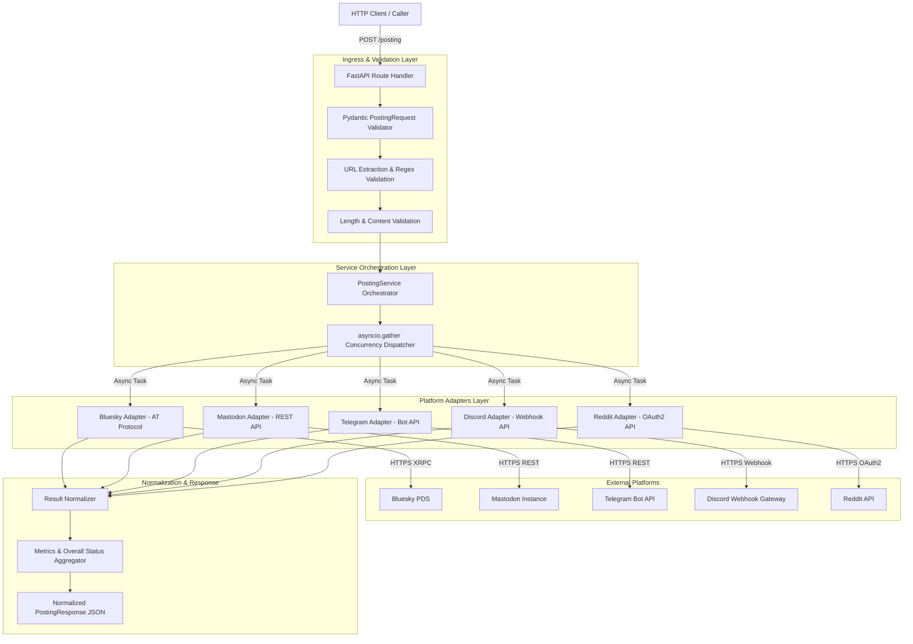

# NEXUS Architecture & System Design

## 1. Architectural Overview

NEXUS is engineered as a modular, decoupled, asynchronous publishing engine designed around the **Adapter Pattern** and **Dependency Injection**. It ensures that third-party platform differences (authentication, payloads, endpoints, and error handling) are completely isolated from the HTTP presentation and validation layer.

---

## 2. Component Responsibilities

### Presentation & Routing (`app/api/routes.py`, `app/main.py`)
- Exposes standard RESTful endpoints (`POST /posting`, `GET /health`, `GET /platforms`, `GET /`).
- Enforces HTTP 422 Unprocessable Entity status codes with detailed error structures on input validation failures.
- Implements application lifespan management and structured JSON response rendering.

### Validation Engine (`app/utils/validation.py`)
- Validates that the input message is non-empty and does not exceed 200 characters.
- Extracts URLs using strict regex.
- Rejects input with zero URLs or more than one URL.
- Rejects malformed domains, missing network locations, and unsupported schemes (e.g. `ftp://`, `ws://`).

### Service Orchestrator (`app/services/posting_service.py`)
- Manages the collection of registered platform adapters.
- Dispatches concurrent asynchronous publishing tasks using `asyncio.gather()`.
- Wraps each adapter invocation with defensive exception isolation so that internal adapter faults cannot cascade.
- Computes aggregate metrics (`all_success`, `partial_success`, `all_failed`, `no_platforms_configured`).

### Platform Adapter Interface (`app/platforms/base.py`)
- Defines the `BasePlatformAdapter` contract:
  - `platform_name`: Display name.
  - `is_configured()`: Credential discovery check.
  - `publish(message)`: Async execution returning `PlatformResult`.
  - `create_success_result()`, `create_failed_result()`, `create_unconfigured_result()`.
  - UTC timestamp standardizer (`YYYY-MM-DD` and `HH:MM:SS`).

---

## 3. Concurrency & Fault Isolation Guarantees

1. **Non-Blocking Concurrent Execution**:
   Each platform request executes asynchronously via HTTPX over non-blocking sockets. All adapters run concurrently through `asyncio.gather()`. However, because `POST /posting` is a synchronous aggregation endpoint, the total HTTP response time of `/posting` is bounded by the slowest individual platform (or the configured client timeout of 10.0 seconds).
2. **Absolute Fault Isolation**:
   If an adapter raises an unexpected exception or the platform API returns HTTP 401, 429, 500, or drops the connection, the exception is caught, logged, and converted into a `PlatformResult(status=failed)`. Other platforms continue execution unimpeded.
3. **Deterministic Response Guarantees**:
   The engine always returns results for every registered platform, clearly reporting whether each platform succeeded, failed, or was skipped due to missing configuration.
